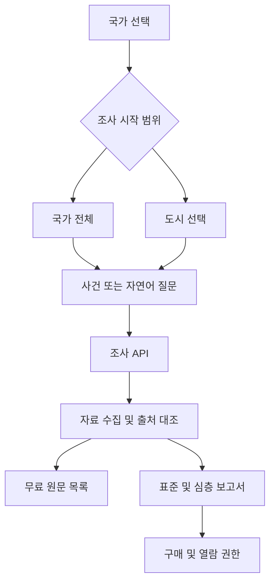

# 아이아카이브 서비스 아키텍처

국가 선택 후 국가 전체를 선택하면 도시를 지정하지 않고 질문한다.
도시를 선택하면 국가와 도시 식별자를 함께 전송하고 서버가 소속 관계를 검증한다.
선택한 지역은 조사 대상의 시작 범위다. 다른 지역이나 국가의 자료가 사건에 관련되면 근거로 포함할 수 있다.
파트너 운영 권역과 구매자의 조사 범위는 별도 데이터로 관리한다.

| 프론트엔드 경로 | 담당 |
|---|---|
| `src/app` | 화면 흐름 |
| `src/features/geography` | 국가·도시 범위 |
| `src/features/investigation` | 사건 질문과 요청 |
| `src/features/sources` | 무료 자료 목록 |
| `src/features/reports` | 표준·심층 보고서 |
| `src/features/sponsors` | 스폰서 영역 |
| `src/features/checkout` | 구매 화면 |
| `src/shared` | 공통 UI 및 API 호출 |

| 백엔드 경로 | 담당 |
|---|---|
| `src/http` | API 진입점 |
| `src/modules/geography` | 국가·도시 카탈로그와 검증 |
| `src/modules/investigations` | 조사 요청과 처리 상태 |
| `src/modules/sources` | 자료 수집과 출처 |
| `src/modules/reports` | 보고서와 검수 |
| `src/modules/billing` | 가격·결제·열람 권한 |
| `src/modules/territories` | 지역·국가 운영권 |
| `src/infra` | Cloudflare 연결과 저장·큐 |

첫 구현에서는 대한민국 전체와 인천을 연결한다. 국가·도시 목록은 서버 카탈로그로 관리한다.
도메인은 iarchieve.com을 사용하고 프론트엔드와 백엔드는 별도 GitHub 저장소에서 관리한다.
